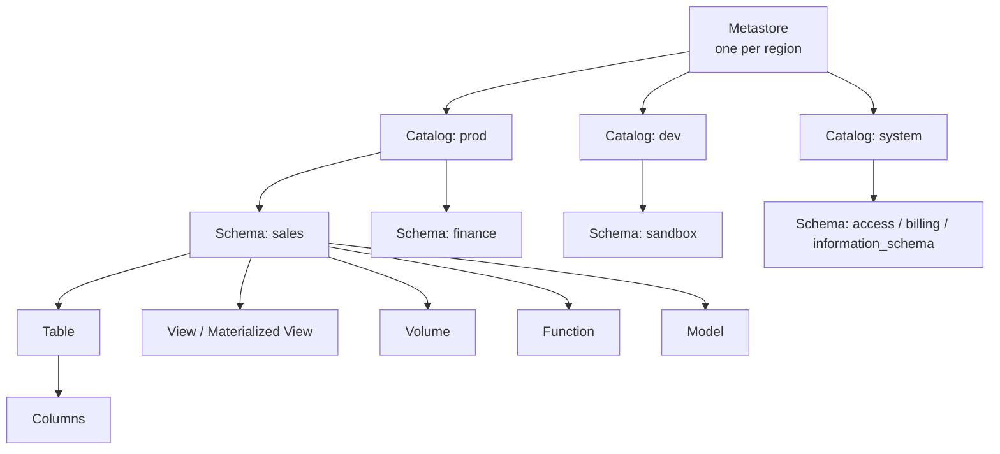

# Unity Catalog in Databricks — Complete Guide

> A practical, end-to-end reference covering concepts, architecture, setup, security,
> governance, operations, and migration for Unity Catalog on Databricks (AWS, Azure, GCP).
>
> **Audience:** data engineers, platform admins, security/governance teams, and analysts.
> **Scope:** Unity Catalog as of the 2024–2025 Databricks platform. Some features are
> preview/GA-gated per cloud and region — always verify the current status in the
> official docs before relying on a feature in production.

---

## Table of Contents

1. [What is Unity Catalog](#1-what-is-unity-catalog)
2. [Why use Unity Catalog](#2-why-use-unity-catalog)
3. [Core concepts and object model](#3-core-concepts-and-object-model)
4. [The metastore](#4-the-metastore)
5. [Storage architecture](#5-storage-architecture)
6. [Setting up Unity Catalog](#6-setting-up-unity-catalog)
7. [Namespaces, naming, and defaults](#7-namespaces-naming-and-defaults)
8. [Identity and access control](#8-identity-and-access-control)
9. [Fine-grained security](#9-fine-grained-security)
10. [Compute and access modes](#10-compute-and-access-modes)
11. [Governance: lineage, audit, discovery](#11-governance-lineage-audit-discovery)
12. [Volumes: governed non-tabular data](#12-volumes-governed-non-tabular-data)
13. [Functions, models, and other securables](#13-functions-models-and-other-securables)
14. [Delta Sharing](#14-delta-sharing)
15. [Lakehouse Federation](#15-lakehouse-federation)
16. [Migrating from the Hive metastore](#16-migrating-from-the-hive-metastore)
17. [Operations, backup, and disaster recovery](#17-operations-backup-and-disaster-recovery)
18. [Security best practices](#18-security-best-practices)
19. [Limitations and caveats](#19-limitations-and-caveats)
20. [Cheat sheet](#20-cheat-sheet)
21. [Troubleshooting common errors](#21-troubleshooting-common-errors)
22. [Glossary](#22-glossary)
23. [References](#23-references)

---

## 1. What is Unity Catalog

**Unity Catalog (UC)** is Databricks' unified governance layer for data and AI assets.
It provides a single, account-wide metadata and permission model that spans:

- **Workspaces** — many workspaces can share one catalog and one permission model.
- **Clouds and regions** — AWS, Azure, and Google Cloud, with one metastore per region.
- **Asset types** — tables, views, materialized views, volumes, functions, ML models,
  notebooks/files, and connections to external systems.
- **Engines** — Databricks SQL warehouses, all-purpose clusters, jobs, serverless
  compute, and supported external engines.

It is **not** a storage system and **not** a query engine. It is the **control plane**
for metadata, permissions, lineage, auditing, and discovery that sits in front of
cloud object storage and external data systems.

### The three-level namespace

Every data object is addressed as:

```
<catalog>.<schema>.<object>
```

For example:

```sql
SELECT * FROM prod.sales.orders;
```

This three-level namespace is the fundamental difference from the legacy Hive
metastore, which used a two-level `database.table` namespace tied to a single
workspace.

### Relationship to the Hive metastore

| Aspect | Hive metastore (legacy) | Unity Catalog |
|---|---|---|
| Namespace | `database.table` | `catalog.schema.table` |
| Scope | Per workspace | Account-wide, per region |
| Permissions | Table ACLs on clusters | Central SQL GRANT model |
| Storage | Direct paths, DBFS | Governed storage credentials |
| Lineage | Not built in | Automatic table/column lineage |
| Audit | Partial | Central audit + system tables |
| Sharing | Manual | Delta Sharing |
| Non-tabular data | DBFS / mounts | Volumes |

`hive_metastore` still exists as a **pseudo-catalog** in UC-enabled workspaces so that
legacy objects remain queryable during migration. New development should target UC
catalogs.

---

## 2. Why use Unity Catalog

- **One permission model** across all workspaces and asset types, instead of
  per-workspace ACLs and per-cluster credentials.
- **Fine-grained access control** down to tables, rows, columns, volumes, and functions.
- **Central auditing** of who accessed what, when, and from where.
- **Automatic lineage** at table and column level for SQL, Python, and jobs.
- **Discovery and search** across the account with comments, tags, and data profiles.
- **Secure external access** via storage credentials instead of long-lived cloud keys.
- **Open sharing** through Delta Sharing (Databricks-to-Databricks and open recipients).
- **Federation** over external databases (PostgreSQL, MySQL, Snowflake, BigQuery, etc.)
  without copying data.
- **AI/ML governance** for models, features, and serving endpoints.
- **Compliance-ready** controls: least privilege, separation of duties, audit trails,
  data classification, and retention.

---

## 3. Core concepts and object model

### Hierarchy



### Securable objects

| Object | Typical use | Parent |
|---|---|---|
| **Metastore** | Top-level metadata container, per region | Account |
| **Catalog** | Environment or domain boundary (prod, dev, marketing) | Metastore |
| **Schema** (database) | Logical grouping inside a catalog | Catalog |
| **Table** | Managed or external Delta/Iceberg table | Schema |
| **View** | Saved query | Schema |
| **Materialized view** | Precomputed, refreshable result set | Schema |
| **Volume** | Governed files (managed or external) | Schema |
| **Function** | UDF / SQL function | Schema |
| **Model** | MLflow model registered in UC | Schema |
| **Storage credential** | Cloud identity used to access storage | Metastore |
| **External location** | Cloud storage path + credential | Metastore |
| **Connection** | Foreign database connection (federation) | Metastore |
| **Share / Recipient / Provider** | Delta Sharing objects | Metastore |
| **Clean room** | Privacy-safe collaboration | Account |

### Managed vs. external objects

| | Managed | External |
|---|---|---|
| **Storage location** | Chosen by UC (metastore / catalog / schema managed location) | Explicit cloud path you own |
| **Lifecycle** | `DROP` deletes metadata **and** data | `DROP` deletes metadata only; data remains |
| **Best for** | Most tables, volumes created by Databricks | Existing data, shared paths, cross-engine access |
| **Governance** | Full | Full metadata governance; data secured by credential |

> **Rule of thumb:** default to **managed** tables. Use external tables when the data
> must outlive the table definition or must be readable outside Databricks.

---

## 4. The metastore

The **metastore** is the top-level UC object. It stores metadata (catalogs, schemas,
tables, privileges, lineage pointers, tags) and defines the default storage root.

Key facts:

- **One metastore per region per account.** Multiple workspaces in the same region
  attach to the same metastore and therefore share catalogs and permissions.
- **A workspace attaches to exactly one metastore**, in the workspace's region.
- Creating and assigning metastores requires **account admin** rights, typically via
  the account console, Account API, or Terraform.
- Cross-region or cross-cloud access is done with **Delta Sharing**, not by attaching
  one metastore to workspaces in different regions.
- A metastore has:
  - a **name** and **metastore ID**,
  - a **storage root** (recommended; enables managed tables and default locations),
  - **admins** (metastore admins),
  - **default data access** configuration (e.g., whether workspace admins can manage
    credentials or external locations),
  - **delta sharing** configuration.

### Metastore roles

- **Account admin** — manages the account, metastores, workspace assignments, and
  identity (SCIM) provisioning. Not automatically a data owner.
- **Metastore admin** — can manage all objects and privileges in the metastore,
  including ownership transfer. Should be a small, tightly controlled group.
- **Workspace admin** — administers a workspace (clusters, jobs, users) but has **no
  implicit UC data privileges**.
- **Data owner** — owns a catalog/schema/table and can grant on it.
- **User / group / service principal** — consumes data subject to grants.

> **Critical distinction:** workspace admin ≠ metastore admin ≠ data access. UC
> privileges are separate from workspace administration.

### Default catalogs

Most UC-enabled accounts include:

- `main` — general-purpose catalog created at metastore setup.
- `hive_metastore` — pseudo-catalog exposing legacy Hive metastore objects.
- `system` — operational system tables (audit, lineage, billing, compute,
  information schema).
- `samples` — Databricks sample datasets.
- Internal catalogs beginning with `__databricks_internal` — reserved.

---

## 5. Storage architecture

Unity Catalog separates **metadata governance** from **data storage**. Access to data
is brokered through **storage credentials**, so users never receive long-lived cloud
keys.

### Components

```
Cloud storage (S3 / ADLS Gen2 / GCS)
        ▲
        │  accessed via
        │
Storage credential  ──►  External location  ──►  External tables / volumes / paths
        ▲
        │  referenced by
        │
Metastore storage root  ──►  Managed tables / volumes
```

#### Storage credential

A UC object wrapping a cloud identity:

- **AWS:** IAM role with a trust policy for Databricks, plus an S3 bucket policy.
- **Azure:** Access connector / managed identity (or service principal) with
  `Storage Blob Data Contributor` on the storage account.
- **GCP:** service account with bucket-level IAM.

Created with `CREATE STORAGE CREDENTIAL` and requires the `CREATE STORAGE CREDENTIAL`
privilege on the metastore (usually restricted to admins).

#### External location

A UC object combining a **cloud path** with a **storage credential**:

```sql
CREATE EXTERNAL LOCATION prod_raw
URL 's3://my-prod-bucket/raw'
WITH (STORAGE CREDENTIAL prod_s3_credential)
COMMENT 'Raw landing zone';
```

Privileges on external locations:

- `READ FILES` — read files at the path.
- `WRITE FILES` — write files at the path.
- `CREATE EXTERNAL TABLE` — create external tables rooted at the path.
- `CREATE MANAGED STORAGE` — designate the path as a managed storage location.
- `BROWSE` — discover the location.

External locations are how you grant **path-level** access without exposing the
underlying credential.

#### Managed storage locations

Managed tables live under a managed location, resolved in this order:

1. **Schema** managed location, if set.
2. **Catalog** managed location, if set.
3. **Metastore** storage root.

```sql
CREATE CATALOG prod
  MANAGED LOCATION 's3://my-prod-bucket/uc/prod';

CREATE SCHEMA prod.sales
  MANAGED LOCATION 's3://my-prod-bucket/uc/prod/sales';
```

Setting catalog/schema managed locations lets you isolate storage per domain or
environment while retaining a shared metastore.

#### Credential vending

When a query runs, Databricks **vends short-lived credentials** (e.g., STS tokens for
S3, SAS tokens for ADLS) scoped to the objects the user is authorized to read. This
is why direct path access can be blocked while governed access still works.

#### Why `dbfs:/mnt` and raw paths are discouraged

Mounts and direct `dbfs:/` paths bypass UC's permission model and rely on
cluster-level credentials. With UC:

- Use **external locations** and **volumes** instead of mounts.
- Use **tables/views** for structured data.
- Deny direct cloud-path access in IAM where possible.

---

## 6. Setting up Unity Catalog

### Prerequisites

- A Databricks **account** (not just a workspace) on a supported cloud and region.
- **Account admin** access.
- Cloud storage bucket/container and permissions to create IAM roles or managed
  identities.
- Network access from workspaces to storage (private link / firewall rules as needed).

### High-level steps

1. **Create the metastore** in the account console (or Account API / Terraform),
   including the storage root and (optionally) a metastore admin group.
2. **Assign workspaces** in the same region to the metastore.
3. **Create a storage credential** for the metastore root and any external buckets.
4. **Create external locations** for governed paths.
5. **Create catalogs and schemas** for environments/domains.
6. **Grant privileges** to groups and service principals.
7. **Set the workspace default catalog** so `USE SCHEMA` resolves predictably.
8. **Migrate or recreate** Hive metastore objects as needed (see §16).
9. **Enable audit log delivery** and system tables.
10. **Enable lineage** (on by default for UC) and validate in Catalog Explorer.

### Via the account console (UI)

1. Sign in to the **account console**.
2. Go to **Data** → **Metastores** → **Create metastore**.
3. Provide name, region, and storage root (e.g., `s3://bucket/uc-metastore`).
4. Assign workspaces.
5. In a workspace, open **Catalog** → **Create** → **Catalog**.
6. Use **Catalog Explorer** to manage grants, tags, and lineage.

### Via the Databricks CLI

```bash
# Authenticate (OAuth or PAT)
databricks auth login --host https://<workspace>.cloud.databricks.com

# Metastore (account-level; needs account host + account admin)
databricks metastores create --name prod-metastore \
  --storage-root s3://my-uc-bucket/metastore --region us-east-1

databricks metastores assign --workspace-id <id> --metastore-id <metastore-id>

# Storage credential and external location
databricks storage-credentials create --json '{
  "name": "prod_s3_credential",
  "aws_iam_role": {"role_arn": "arn:aws:iam::123456789012:role/databricks-uc"}
}'

databricks external-locations create --json '{
  "name": "prod_raw",
  "url": "s3://my-prod-bucket/raw",
  "credential_name": "prod_s3_credential"
}'

# Catalog and schema
databricks catalogs create --name prod --comment "Production"
databricks schemas create --catalog-name prod --name sales

# Grants
databricks grants update --json '{
  "changes": [
    {"principal": "data-engineers", "add": ["USE_CATALOG", "USE_SCHEMA", "SELECT"]}
  ]
}' --securable-type CATALOG --full-name prod
```

### Via Terraform (recommended for IaC)

```hcl
resource "databricks_metastore" "this" {
  name          = "prod-metastore"
  storage_root  = "s3://my-uc-bucket/metastore"
  region        = "us-east-1"
  force_destroy = false
}

resource "databricks_metastore_assignment" "this" {
  metastore_id = databricks_metastore.this.id
  workspace_id = var.workspace_id
}

resource "databricks_storage_credential" "prod" {
  name = "prod_s3_credential"
  aws_iam_role { role_arn = aws_iam_role.uc.arn }
}

resource "databricks_external_location" "raw" {
  name            = "prod_raw"
  url             = "s3://my-prod-bucket/raw"
  credential_name = databricks_storage_credential.prod.name
}

resource "databricks_catalog" "prod" {
  name          = "prod"
  comment       = "Production"
  properties    = { environment = "prod" }
  force_destroy = false
}

resource "databricks_schema" "sales" {
  catalog_name = databricks_catalog.prod.name
  name         = "sales"
}

resource "databricks_grants" "prod_catalog" {
  catalog = databricks_catalog.prod.name
  grant {
    principal  = "data-engineers"
    privileges = ["USE_CATALOG", "USE_SCHEMA", "SELECT"]
  }
}
```

### Via REST API

All UC operations are exposed under:

```
/api/2.1/unity-catalog/<resource>
```

Examples: `/catalogs`, `/schemas`, `/tables`, `/volumes`, `/grants`,
`/storage-credentials`, `/external-locations`, `/metastores`, `/shares`,
`/recipients`, `/connections`.

---

## 7. Namespaces, naming, and defaults

### Rules and conventions

- Fully qualified name: `catalog.schema.object`.
- Identifiers are **case-insensitive** but original casing is preserved.
- Use **lowercase snake_case** for catalogs, schemas, and objects to avoid quoting
  issues.
- Avoid spaces, dots, and special characters; quote identifiers only when necessary
  with backticks: `` `my catalog`.`my schema`.`my table` ``.
- Object names can be up to **255 characters** (metastore-wide uniqueness rules apply
  per object type and namespace).

### Suggested catalog layout

| Catalog | Purpose | Example schemas |
|---|---|---|
| `prod` | Production data | `sales`, `finance`, `marketing` |
| `dev` | Development | `sandbox`, `feature_x` |
| `raw` | Landing/bronze | `events`, `cdc` |
| `sandbox_<user>` | Personal exploration | `tmp` |
| `system` | Operational data | `access`, `billing`, `information_schema` |
| `shared` | Cross-team/Delta Sharing | `partner_a` |

Separating by **environment** and **domain** is more scalable than a single catalog
with many schemas, because catalogs are the main isolation boundary for storage,
ownership, and grants.

### Default catalog and schema

- A workspace can have a **default catalog**; otherwise `main` is used.
- `USE CATALOG prod;` and `USE SCHEMA sales;` set the session context.
- Always use fully qualified names in production code to avoid context bugs.

```sql
USE CATALOG prod;
USE SCHEMA sales;
SELECT * FROM orders;              -- resolves to prod.sales.orders
SELECT * FROM prod.sales.orders;   -- explicit, preferred
```

---

## 8. Identity and access control

### Identities

UC grants apply to:

- **Users** — individual accounts (email-based).
- **Groups** — account-level groups synced from the identity provider via SCIM.
- **Service principals** — non-human identities for automation, jobs, and apps.
- **`account users`** — built-in group containing all account users.

> Always grant to **groups** and **service principals**, not individuals. Manage
> membership in the identity provider, not in ad-hoc grant statements.

### The grant model

```sql
GRANT <privilege> ON <securable> TO <principal>;
REVOKE <privilege> ON <securable> FROM <principal>;
SHOW GRANTS ON <securable>;
SHOW GRANTS TO <principal>;
```

### Privilege inheritance

Privileges flow **down** the hierarchy:

```
Metastore
  └── Catalog        (USE CATALOG)
        └── Schema   (USE SCHEMA)
              └── Table/View/Volume/Function  (SELECT, MODIFY, EXECUTE, ...)
```

Important details:

- To query `prod.sales.orders`, a user needs `USE CATALOG` on `prod`, `USE SCHEMA`
  on `prod.sales`, and `SELECT` on the table (or a parent-level grant that covers it).
- Granting `SELECT` on a **schema** applies to all current and future tables in it.
- `ALL PRIVILEGES` grants the full set valid for that object type, but does **not**
  include `MANAGE` or ownership-only abilities.
- **Ownership** is stronger than grants: an owner can grant any privilege on the
  object and transfer ownership. Ownership is a single principal, not a group by
  default (groups can own objects, but prefer service principals for automation).

### Privilege reference

| Privilege | Applies to | Meaning |
|---|---|---|
| `USE CATALOG` | Catalog | Enter the catalog namespace |
| `USE SCHEMA` | Schema | Enter the schema namespace |
| `SELECT` | Table, view, schema, catalog | Read data |
| `MODIFY` | Table, schema, catalog | Insert/update/delete data |
| `CREATE TABLE` | Schema, catalog | Create tables |
| `CREATE VIEW` | Schema, catalog | Create views |
| `CREATE MATERIALIZED VIEW` | Schema, catalog | Create materialized views |
| `CREATE FUNCTION` | Schema, catalog | Create functions |
| `CREATE VOLUME` | Schema, catalog | Create volumes |
| `CREATE MODEL` | Schema, catalog | Register models |
| `EXECUTE` | Function, model | Run/load |
| `READ VOLUME` | Volume | Read files |
| `WRITE VOLUME` | Volume | Write files |
| `REFRESH` | Materialized view | Refresh |
| `BROWSE` | Catalog, schema, object | Discover without data access |
| `APPLY TAG` | Securable, column | Add governed tags |
| `MANAGE` | Catalog, schema, object | Manage grants/ownership without data read |
| `CREATE SCHEMA` | Catalog | Create schemas |
| `CREATE CATALOG` | Metastore | Create catalogs |
| `CREATE STORAGE CREDENTIAL` | Metastore | Create credentials |
| `CREATE EXTERNAL LOCATION` | Metastore | Create external locations |
| `CREATE CONNECTION` / `USE CONNECTION` | Metastore | Federation |
| `CREATE SHARE` / `USE SHARE` | Metastore / share | Delta Sharing |
| `CREATE RECIPIENT` / `USE RECIPIENT` | Metastore / recipient | Delta Sharing |
| `CREATE PROVIDER` / `USE PROVIDER` | Metastore / provider | Delta Sharing |
| `READ FILES` / `WRITE FILES` | External location, volume | Raw file access |
| `CREATE EXTERNAL TABLE` | External location | Create external tables there |
| `CREATE MANAGED STORAGE` | External location | Use as managed storage |
| `ALL PRIVILEGES` | Any | All valid privileges for the type |

### Practical grant patterns

**Read-only analyst group:**

```sql
GRANT USE_CATALOG ON CATALOG prod TO analysts;
GRANT USE_SCHEMA  ON SCHEMA prod.sales TO analysts;
GRANT SELECT      ON SCHEMA prod.sales TO analysts;
```

**Engineering group with write access to one schema:**

```sql
GRANT USE_CATALOG ON CATALOG prod TO data-engineers;
GRANT USE_SCHEMA, CREATE_TABLE, CREATE_VIEW, SELECT, MODIFY
  ON SCHEMA prod.sales TO data-engineers;
```

**Service principal for a job:**

```sql
GRANT USE_CATALOG ON CATALOG prod TO `spn-orders-etl`;
GRANT USE_SCHEMA, SELECT, MODIFY ON SCHEMA prod.sales TO `spn-orders-etl`;
```

**Discovery without data access (data catalog browsing):**

```sql
GRANT BROWSE ON CATALOG prod TO `all-users`;
```

**Ownership for a platform team:**

```sql
ALTER CATALOG prod OWNER TO `platform-admins`;
ALTER SCHEMA prod.sales OWNER TO `sales-data-owners`;
```

### Grants on storage

```sql
GRANT READ FILES, WRITE FILES ON EXTERNAL LOCATION prod_raw TO data-engineers;
GRANT CREATE EXTERNAL TABLE ON EXTERNAL LOCATION prod_raw TO data-engineers;
GRANT READ VOLUME, WRITE VOLUME ON VOLUME prod.landing.files TO ingest-spn;
```

> `CREATE EXTERNAL TABLE` on an external location is what allows users to create
> tables at that path. Without it, only admins or granted principals can.

### Group nesting and `is_account_group_member`

UC honors **account group membership**, including nested groups from SCIM. Use
`is_account_group_member('group-name')` in SQL logic (e.g., dynamic views) to check
membership at query time.

### Ownership vs. `MANAGE`

- **Owner**: full control, including grant and transfer ownership.
- **`MANAGE`**: can grant/revoke on the object and view grants, but cannot read data
  and cannot transfer ownership.

---

## 9. Fine-grained security

UC supports several layers of fine-grained control beyond table-level grants.

### 9.1 Dynamic views

A **dynamic view** filters rows or masks columns based on the **querying user's**
identity or group membership.

```sql
CREATE VIEW prod.sales.orders_secure AS
SELECT
  order_id,
  customer_id,
  CASE
    WHEN is_account_group_member('sales-managers') THEN amount
    ELSE NULL
  END AS amount,
  region,
  order_date
FROM prod.sales.orders
WHERE is_account_group_member('sales-team')
   OR is_account_group_member('sales-managers');
```

- Views run with **definer's rights** by default for data access, but row/column
  logic can use the **invoker's** identity via `current_user()` and
  `is_account_group_member()`.
- Grant `SELECT` on the **view**, not the underlying table.
- Dynamic views are the classic pattern for row-level and column-level security.

### 9.2 Row filters

Row filters attach a **SQL UDF returning BOOLEAN** to a table. The function receives
the filter columns and decides visibility per row.

```sql
CREATE FUNCTION prod.sales.region_filter(region STRING)
RETURN is_account_group_member('global-sales')
    OR region = current_user_region();

ALTER TABLE prod.sales.orders
  SET ROW FILTER prod.sales.region_filter ON (region);
```

- Users need `SELECT` on the table; they do not need `EXECUTE` on the filter
  function (the filter runs in the table's security context — verify current docs).
- Remove with `ALTER TABLE ... DROP ROW FILTER`.
- Works with tables, views where supported, and is enforced across engines.

### 9.3 Column masks

Column masks replace a column's value with the result of a UDF for unauthorized
users.

```sql
CREATE FUNCTION prod.sales.mask_email(email STRING)
RETURN CASE
  WHEN is_account_group_member('pii-authorized') THEN email
  ELSE '***@***.***'
END;

ALTER TABLE prod.sales.customers
  ALTER COLUMN email SET MASK prod.sales.mask_email;
```

- Remove with `ALTER TABLE ... ALTER COLUMN email DROP MASK`.
- Masking applies to `SELECT *` and direct column references.
- Combine with row filters for defense in depth.

### 9.4 Tags and attribute-based governance

Tags classify objects and columns and can drive policy, discovery, and cost
attribution.

```sql
ALTER TABLE prod.sales.customers SET TAGS ('domain' = 'sales', 'tier' = 'gold');
ALTER TABLE prod.sales.customers
  ALTER COLUMN email SET TAGS ('pii' = 'true', 'classification' = 'confidential');

ALTER TABLE prod.sales.customers UNSET TAGS ('tier');
```

- **System tags** are set by Databricks (e.g., source, creator).
- **Governed tags** are centrally defined in the account and require `APPLY TAG`.
- Tags are searchable in Catalog Explorer and available in `information_schema`.
- **Attribute-based access control (ABAC)** builds on governed tags to apply
  policies at scale. Availability is preview/GA by cloud and region — confirm status
  before designing around it.

### 9.5 Column-level grants vs. masks

- Prefer **column masks** or **dynamic views** when you need value-level redaction.
- `GRANT SELECT` is table-wide; there is no per-column `GRANT SELECT(col)` in UC.
  Use a view or mask instead.
- Views should expose only the columns a consumer needs.

### 9.6 Row-level security decision guide

| Need | Use |
|---|---|
| Hide rows by region/tenant/group | Row filter or dynamic view |
| Redact PII for most users | Column mask |
| Curated, stable interface for consumers | View |
| Both row and column logic | Row filter + column mask, or one dynamic view |
| Policy driven by classification | Governed tags (+ ABAC where available) |

---

## 10. Compute and access modes

Unity Catalog enforcement depends on **compute access mode**. Not all cluster types
support UC.

### Access modes

| Access mode | Former name | UC support | Isolation | Typical use |
|---|---|---|---|---|
| **Dedicated** | Single user | Yes | One principal per cluster | ETL, ML, admin work |
| **Standard** | Shared | Yes (required for UC isolation) | User-level isolation | Multi-user SQL/Python workloads |
| **No isolation shared** | None | No | None | Legacy only; avoid |
| **Serverless** | — | Yes (required) | Managed | SQL warehouses, jobs, notebooks |

Notes:

- **Standard** access mode requires UC and provides user isolation; language support
  (Python, SQL, R, Scala) varies by runtime version — check the compatibility matrix.
- **Dedicated** is simplest and most permissive but ties the cluster to one identity.
- **Serverless** compute always uses UC and is the recommended default for SQL and
  many jobs.
- Clusters with `data_security_mode=NONE` or legacy table ACLs cannot access UC data.

### SQL warehouses

- **Serverless** and **Pro** SQL warehouses support UC.
- **Classic** warehouses support UC if configured with a UC-compatible access mode.
- Warehouse permissions are separate from data permissions; a user needs both
  `CAN USE` on the warehouse and data grants.

### Jobs and notebooks

- Jobs run as the **job owner** or a configured **run-as** service principal.
- Grant the run-as principal the required UC privileges.
- Notebooks attached to UC clusters inherit the **notebook user's** identity for
  queries (in standard mode) or the cluster's identity (in dedicated mode).

### External engines

UC metadata can be read by external engines through:
- **Delta Sharing** (open protocol),
- **Iceberg REST catalog** compatibility for supported setups,
- **Lakehouse Federation** for querying external systems from Databricks.

### Credential and path behavior

- Users cannot read `s3://` / `abfss://` / `gs://` paths directly unless granted
  file privileges via external locations or volumes.
- `dbfs:/mnt` mounts bypass UC; migrate to external locations.
- Some libraries and Spark APIs require path-based access — use **volumes** for
  those.

---

## 11. Governance: lineage, audit, discovery

### 11.1 Lineage

UC captures **table-level** and **column-level** lineage automatically for:

- SQL queries and DBSQL dashboards,
- PySpark DataFrame operations,
- Jobs and notebooks,
- Some MLflow model and feature flows.

Where to find it:

- **Catalog Explorer** → object → **Lineage** tab (upstream/downstream graph).
- **System tables**: `system.access.table_lineage` and
  `system.access.column_lineage`.

```sql
SELECT *
FROM system.access.table_lineage
WHERE source_table_full_name = 'prod.sales.orders'
ORDER BY event_time DESC
LIMIT 100;
```

Lineage helps with impact analysis, root-cause debugging, and compliance evidence.
It is metadata-based and depends on UC-aware compute; dynamic path-based reads may
not be captured.

### 11.2 Audit logs

Every UC operation (grant changes, data access, credential use, metastore changes)
is audited.

Two consumption paths:

1. **Diagnostic log delivery** to cloud storage (S3/ADLS/GCS) — long-term retention.
2. **System table** `system.access.audit` — queryable in Databricks SQL.

```sql
SELECT event_time, user_identity.email, action_name, request_params
FROM system.access.audit
WHERE action_name = 'getTable'
  AND request_params.table_full_name = 'prod.sales.orders'
  AND event_date >= current_date() - 7
ORDER BY event_time DESC;
```

Common `action_name` values include `getTable`, `commandSubmit`, `createTable`,
`deleteTable`, `updatePermissions`, `createCatalog`, `getTableLineage`.

### 11.3 System tables

The `system` catalog exposes operational data. Common schemas:

| Schema | Tables | Purpose |
|---|---|---|
| `system.access` | `audit`, `table_lineage`, `column_lineage`, `workspace_access` | Security and lineage |
| `system.billing` | `usage`, `list_prices` | Cost and usage |
| `system.compute` | `clusters`, `node_timeline`, `warehouses` | Compute inventory |
| `system.information_schema` | `catalogs`, `schemata`, `tables`, `columns`, `volumes`, `table_privileges`, ... | Metadata |
| `system.data_classification` | `results` | Data classification findings |
| `system.mlflow` | model/experiment metadata | ML governance |

Access requires `USE CATALOG system` plus grants on the relevant schema/table
(metastore admins manage these).

### 11.4 Information schema

Every catalog exposes an `information_schema` for that catalog:

```sql
SELECT table_catalog, table_schema, table_name, table_type
FROM prod.information_schema.tables
WHERE table_schema = 'sales';

SELECT grantee, privilege_type
FROM prod.information_schema.table_privileges
WHERE table_name = 'orders';
```

Use `system.information_schema` for account-wide inventory across catalogs
(permissions permitting).

### 11.5 Discovery and documentation

- **Catalog Explorer** — browse, search, preview data, view lineage, grants, tags.
- **Comments** — document objects with `COMMENT ON` or `ALTER ... SET TBLPROPERTIES`.
- **Tags** — classify and filter.
- **Search** — across object names, comments, and tags.
- **Data profiles** — column statistics and quality signals (where enabled).
- **Favorites** and **shared** items for team workflows.

```sql
COMMENT ON TABLE prod.sales.orders IS 'One row per order; source: Shopify';
COMMENT ON COLUMN prod.sales.orders.amount IS 'Gross amount in USD';
```

### 11.6 Data classification

Databricks can scan UC tables to detect sensitive data (PII, financial, etc.) and
write findings to `system.data_classification.results`. Use it to prioritize
masking, tagging, and access reviews. Availability varies by cloud and tier.

---

## 12. Volumes: governed non-tabular data

**Volumes** provide governed access to files (CSV, JSON, images, models, binaries)
inside the UC namespace.

- Path format: `/Volumes/<catalog>/<schema>/<volume>/<path>`
- **Managed volume** — storage managed by UC.
- **External volume** — backed by an external location you control.
- Privileges: `READ VOLUME`, `WRITE VOLUME` (plus `USE CATALOG` / `USE SCHEMA`).

```sql
CREATE VOLUME prod.landing.raw_files
COMMENT 'Landing zone for raw uploads';

CREATE EXTERNAL VOLUME prod.landing.archive
LOCATION 's3://my-prod-bucket/archive'
COMMENT 'Long-term archive';
```

Usage:

```python
df = spark.read.csv("/Volumes/prod/landing/raw_files/2025/01/orders.csv", header=True)
df.write.mode("append").saveAsTable("prod.sales.orders_staging")
```

```sql
COPY INTO prod.sales.orders_staging
FROM '/Volumes/prod/landing/raw_files/2025/01/'
FILEFORMAT = CSV
FORMAT_OPTIONS ('header' = 'true');
```

```bash
databricks fs cp ./local.csv dbfs:/Volumes/prod/landing/raw_files/upload.csv
```

Best practices:

- Use volumes instead of DBFS mounts.
- Scope volumes per domain and grant at the volume level.
- For high-throughput ingestion, prefer `COPY INTO`, Auto Loader, or `spark.read`
  from volumes.

---

## 13. Functions, models, and other securables

### Functions

```sql
CREATE FUNCTION prod.sales.normalize_region(r STRING)
RETURNS STRING
RETURN upper(trim(r));

GRANT EXECUTE ON FUNCTION prod.sales.normalize_region TO analysts;
```

- Python UDFs and SQL functions are supported.
- Use functions for row filters, column masks, and reusable logic.
- `EXECUTE` is the privilege; ownership allows modification.

### Models (MLflow Model Registry in UC)

```sql
CREATE MODEL prod.ml.churn_model
COMMENT 'Churn propensity model';

GRANT EXECUTE ON MODEL prod.ml.churn_model TO scoring-spn;
```

- Three-level namespace: `catalog.schema.model`.
- Versions and aliases (`champion`, `challenger`) are supported.
- Models inherit lineage from training data where captured.
- Serving endpoints and batch scoring respect UC grants of the calling principal.

### Notebooks and workspace files

Workspace objects (notebooks, files) are governed by workspace ACLs, not UC
privileges. UC governs **data** assets; workspace ACLs govern **code**. Some newer
features integrate workspace file permissions with UC — check current docs.

### Connections

```sql
CREATE CONNECTION prod_pg
TYPE POSTGRESQL
OPTIONS (
  host 'pg.example.com',
  port '5432',
  user 'databricks',
  password secret('prod', 'pg-password')
);
```

Connections are metastore-level and used by foreign catalogs.

---

## 14. Delta Sharing

**Delta Sharing** is an open protocol for sharing data across organizations,
clouds, and regions without copying it.

### Databricks-to-Databricks

```sql
-- Provider side
CREATE SHARE sales_share COMMENT 'Sales data for partners';
ALTER SHARE sales_share ADD TABLE prod.sales.orders;
ALTER SHARE sales_share ADD SCHEMA prod.sales;   -- or entire schema
ALTER SHARE sales_share ADD VOLUME prod.landing.raw_files;

-- Recipient (Databricks account)
CREATE RECIPIENT partner_a
USING ID 'xxxxxxxx-xxxx-xxxx-xxxx-xxxxxxxxxxxx';

GRANT SELECT ON SHARE sales_share TO RECIPIENT partner_a;
```

```sql
-- Recipient side (after provider shares with you)
CREATE CATALOG partner_sales
USING SHARE provider_org.sales_share;

SELECT * FROM partner_sales.sales.orders;
```

### Open sharing (non-Databricks recipients)

- Create a recipient with a **sharing token** or activation link.
- The recipient downloads a **profile file** and uses any Delta Sharing client
  (Spark, pandas, Power BI, Tableau, etc.).
- Data is read via short-lived, scoped URLs.

### What can be shared

- Tables (Delta), views (as tables), volumes (files), and selected schemas.
- Partition filtering and history sharing options.
- **Clean rooms** enable privacy-safe joins without exposing raw rows.

### Governance for shares

- `CREATE SHARE` on metastore, ownership of the share, and `SELECT` on shared
  objects are required.
- Recipients only see what is explicitly added.
- Audit records share creation and access.

---

## 15. Lakehouse Federation

Federation lets Databricks query external databases **without copying data** by
creating a **foreign catalog** backed by a **connection**.

```sql
CREATE CONNECTION prod_mysql
TYPE MYSQL
OPTIONS (
  host 'mysql.example.com',
  port '3306',
  user 'reader',
  password secret('prod', 'mysql-password')
);

CREATE FOREIGN CATALOG mysql_prod
USING CONNECTION prod_mysql
OPTIONS (database 'sales');

SELECT * FROM mysql_prod.sales.orders LIMIT 10;
```

Supported sources typically include PostgreSQL, MySQL, SQL Server, Oracle, Amazon
Redshift, Snowflake, BigQuery, Azure Synapse, and Databricks-to-Databricks. Exact
support varies — confirm in the docs.

Notes:

- Foreign catalogs are **read-oriented** (some sources support writes).
- Performance depends on pushdown; filters and projections are pushed where possible.
- Grants work like normal UC catalogs: `USE CATALOG`, `USE SCHEMA`, `SELECT`.
- Credentials are stored in the connection, not in code.

---

## 16. Migrating from the Hive metastore

Legacy Hive metastore (HMS) objects are workspace-scoped and use DBFS paths. Moving
to UC involves both **metadata** and **data** decisions.

### Options

1. **Upgrade Wizard (UI)** — guided flow to convert HMS tables to UC. Handles managed
   tables, external tables, and views (with limitations).
2. **`SYNC` for external tables** — registers existing external table metadata in UC
   so the data stays in place. Verify exact syntax for your runtime.
3. **Deep clone** — `CREATE TABLE uc.table DEEP CLONE hive_metastore.db.table` copies
   data and metadata; good for managed tables moving to new storage.
4. **Shallow clone** — copies metadata only, referencing source files; source must
   remain readable and is not fully independent.
5. **Recreate + rewrite** — for views, complex schemas, or when storage layout should
   change.

```sql
-- Deep clone a managed table into UC
CREATE TABLE prod.sales.orders
DEEP CLONE hive_metastore.legacy_sales.orders;

-- Shallow clone (metadata only)
CREATE TABLE prod.sales.orders
SHALLOW CLONE hive_metastore.legacy_sales.orders;
```

### Migration checklist

- Inventory HMS tables, views, and paths (`SHOW TABLES`, `DESCRIBE EXTENDED`).
- Classify: managed vs. external, Delta vs. Parquet/other.
- Create target catalogs/schemas and managed locations.
- Create storage credentials and external locations for existing buckets.
- Migrate tables (clone or sync), then validate row counts and schemas.
- Recreate views; review logic for path references and `dbfs:/` usage.
- Update jobs, notebooks, dashboards, and SQL to three-level names.
- Re-grant privileges (ACLs do not carry over).
- Freeze or redirect writes; cut over; monitor lineage and audit.
- Decommission mounts and legacy paths after validation.

### Common migration pitfalls

- Hard-coded `dbfs:/mnt/...` paths in code.
- Views referencing HMS-only functions or paths.
- External tables whose bucket lacks a storage credential.
- Missing `USE CATALOG` / `USE_SCHEMA` grants causing "not found" errors.
- Case sensitivity differences in identifiers.
- Jobs running as service principals without updated grants.

---

## 17. Operations, backup, and disaster recovery

### Metadata backup

UC metadata (catalogs, schemas, grants, tags, comments) is managed by Databricks, but
you should still keep your own **infrastructure-as-code** definitions:

- Terraform for catalogs, schemas, grants, credentials, locations, volumes.
- Version-controlled SQL migration scripts.
- Exports of `information_schema` inventories and `SHOW GRANTS` output.

### Data backup

- **Deep clone** tables for point-in-time copies within or across catalogs.
- **Delta time travel** for versioned recovery: `SELECT * FROM t VERSION AS OF 5`.
- **Restore**: `RESTORE TABLE t TO VERSION AS OF 5` (Delta).
- **Cloud-native backups** (S3 versioning, Azure Backup, GCS retention) for the
  underlying buckets.
- **Cross-region/cross-account** copies via Delta Sharing or deep clone to a
  replicated bucket.

### Disaster recovery patterns

- **Same region, multi-workspace**: shared metastore gives consistent governance;
  protect the storage account and metastore region.
- **Cross region**: replicate data to a secondary region bucket and use a second
  metastore there (one per region), or Delta Sharing for read access.
- **Cross cloud**: Delta Sharing or scheduled copies.
- Document RPO/RTO and test restores regularly.

### Cost and usage monitoring

```sql
SELECT usage_date, sku_name, sum(usage_quantity) AS dbus
FROM system.billing.usage
WHERE usage_date >= current_date() - 30
GROUP BY usage_date, sku_name
ORDER BY usage_date DESC;
```

Use tags on warehouses/clusters and catalog/schema tags for chargeback.

### Maintenance

- `OPTIMIZE` and `VACUUM` Delta tables per retention policy.
- `ANALYZE TABLE ... COMPUTE STATISTICS` for query planning.
- Refresh materialized views on schedule.
- Review grants and unused objects quarterly.
- Rotate storage credentials and service principal secrets.

---

## 18. Security best practices

1. **Least privilege** — grant the minimum privileges to groups, at the highest
   sensible level, and avoid `ALL PRIVILEGES` on broad scopes.
2. **Groups, not individuals** — manage membership in the IdP via SCIM.
3. **Separate duties** — metastore admins, credential managers, and data owners
   should be different people.
4. **No long-lived cloud keys** — use storage credentials and external locations.
5. **No DBFS mounts for new work** — use volumes and external locations.
6. **Deny direct path access** in cloud IAM except through Databricks identities.
7. **Encrypt** — rely on cloud-native encryption at rest; enable customer-managed
   keys where required; TLS in transit.
8. **Network controls** — private link / private endpoints, IP access lists,
   firewall rules, no public bucket access.
9. **Audit everything** — enable diagnostic log delivery and monitor
   `system.access.audit`; alert on grant changes and sensitive-table access.
10. **Classify and tag** — identify PII/confidential data, apply masks and row
    filters, and review tags regularly.
11. **Protect `system` and `__databricks_internal`** — restrict access to operators.
12. **Harden sharing** — review shares and recipients; revoke stale recipients.
13. **Rotate secrets** — service principal secrets, connection passwords, PATs.
14. **Review external locations** — limit `CREATE EXTERNAL LOCATION`,
    `CREATE STORAGE CREDENTIAL`, and `CREATE MANAGED STORAGE` to admins.
15. **Test restores** — a backup you have not restored is not a backup.

### Example: restrictive baseline

```sql
-- Operators only
GRANT CREATE STORAGE CREDENTIAL, CREATE EXTERNAL LOCATION
  ON METASTORE TO `uc-platform-admins`;

-- No broad catalog creation
-- (do not grant CREATE CATALOG to `account users`)

-- Read-only by default for analysts
GRANT USE_CATALOG ON CATALOG prod TO analysts;
GRANT USE_SCHEMA, SELECT ON SCHEMA prod.reporting TO analysts;

-- Sensitive schema: no schema-wide SELECT; use curated views
GRANT USE_CATALOG ON CATALOG prod TO analysts;
GRANT USE_SCHEMA ON SCHEMA prod.pii TO analysts;
GRANT SELECT ON VIEW prod.pii.customers_redacted TO analysts;
```

---

## 19. Limitations and caveats

- **One metastore per region per account**; a workspace attaches to one metastore.
  Cross-region access requires Delta Sharing or copies.
- **Metastore region is fixed** at creation; choose deliberately.
- **Workspace admin does not imply data access**; expect extra grant setup.
- **ACLs do not migrate** from HMS; re-grant explicitly.
- **Name length and character limits** apply; avoid special characters.
- **Case-insensitive identifiers** can surprise code ported from case-sensitive
  systems.
- **Some Delta features** (e.g., certain shallow clone or streaming patterns) have
  UC-specific constraints; check compatibility.
- **Path-based access** for some libraries requires volumes.
- **Access mode constraints**: UC requires dedicated/standard/serverless; legacy
  no-isolation clusters cannot read UC data.
- **Preview features** (ABAC, data classification, some sharing/volume capabilities)
  vary by cloud and region and can change.
- **Row filters/column masks** require supported runtimes and table types; test
  performance on large tables.
- **Foreign catalogs** may not support all write operations or pushdowns.
- **Lineage** is best-effort for dynamic path reads and some external engines.
- **System tables** require enabling and appropriate grants; retention varies.
- **Quotas** (number of catalogs, schemas, grants, shares) exist; consult limits
  docs before very large deployments.

---

## 20. Cheat sheet

### SQL

```sql
-- Namespace
CREATE CATALOG IF NOT EXISTS prod COMMENT 'Production';
CREATE SCHEMA IF NOT EXISTS prod.sales COMMENT 'Sales domain';
USE CATALOG prod;
USE SCHEMA sales;

-- Tables
CREATE TABLE prod.sales.orders (
  order_id BIGINT,
  customer_id BIGINT,
  amount DECIMAL(18,2),
  region STRING,
  order_date DATE
) USING DELTA
COMMENT 'Orders fact table'
TBLPROPERTIES ('quality' = 'gold');

CREATE EXTERNAL TABLE prod.sales.orders_ext (...)
USING DELTA
LOCATION 's3://my-prod-bucket/sales/orders';

-- Grants
GRANT USE_CATALOG ON CATALOG prod TO `analysts`;
GRANT USE_SCHEMA  ON SCHEMA prod.sales TO `analysts`;
GRANT SELECT      ON TABLE prod.sales.orders TO `analysts`;
REVOKE SELECT     ON TABLE prod.sales.orders FROM `contractors`;
SHOW GRANTS ON TABLE prod.sales.orders;
SHOW GRANTS TO `analysts`;

-- Ownership
ALTER TABLE prod.sales.orders OWNER TO `sales-data-owners`;

-- Tags and comments
ALTER TABLE prod.sales.orders SET TAGS ('domain' = 'sales');
COMMENT ON TABLE prod.sales.orders IS 'Order fact';

-- Storage
CREATE STORAGE CREDENTIAL prod_cred
WITH (AWS_IAM_ROLE 'arn:aws:iam::123456789012:role/databricks-uc');

CREATE EXTERNAL LOCATION prod_raw
URL 's3://my-prod-bucket/raw'
WITH (STORAGE CREDENTIAL prod_cred);

-- Volumes
CREATE VOLUME prod.landing.files;
GRANT READ VOLUME, WRITE VOLUME ON VOLUME prod.landing.files TO `ingest-spn`;

-- Row filter and mask
ALTER TABLE prod.sales.orders
  SET ROW FILTER prod.sales.region_filter ON (region);
ALTER TABLE prod.sales.customers
  ALTER COLUMN email SET MASK prod.sales.mask_email;

-- Sharing
CREATE SHARE sales_share;
ALTER SHARE sales_share ADD TABLE prod.sales.orders;

-- Federation
CREATE FOREIGN CATALOG mysql_prod USING CONNECTION prod_mysql
OPTIONS (database 'sales');
```

### CLI

```bash
databricks catalogs list
databricks catalogs create --name dev
databricks schemas create --catalog-name dev --name sandbox
databricks tables list --catalog-name dev --schema-name sandbox
databricks volumes create --catalog-name dev --schema-name sandbox --name files
databricks grants update --json @grants.json \
  --securable-type SCHEMA --full-name dev.sandbox
databricks external-locations list
databricks storage-credentials list
databricks metastores get --id <metastore-id>
databricks shares list
databricks recipients list
```

### Python (Databricks SDK)

```python
from databricks.sdk import WorkspaceClient

w = WorkspaceClient()

w.catalogs.create(name="dev", comment="Development")
w.schemas.create(name="sandbox", catalog_name="dev")
w.grants.update(
    securable_type="schema",
    full_name="dev.sandbox",
    changes=[{
        "principal": "data-engineers",
        "add": ["USE_SCHEMA", "SELECT", "MODIFY"],
    }],
)
```

### PySpark

```python
spark.sql("SELECT * FROM prod.sales.orders").show()
spark.sql("GRANT SELECT ON TABLE prod.sales.orders TO `analysts`")
df.write.saveAsTable("prod.sales.orders_staging")
```

---

## 21. Troubleshooting common errors

| Error / symptom | Likely cause | Fix |
|---|---|---|
| `TABLE_OR_VIEW_NOT_FOUND` | Missing `USE CATALOG` / `USE SCHEMA` or wrong name | Use fully qualified name; grant `USE` privileges |
| `PERMISSION_DENIED: User does not have SELECT` | No grant on table/schema | `GRANT SELECT` and verify inheritance |
| `CATALOG_NOT_FOUND` | Workspace not attached to metastore, or catalog missing | Check metastore assignment; create catalog |
| `INVALID_STORAGE_CREDENTIAL` | IAM trust/policy or managed identity wrong | Validate role trust, bucket policy, network |
| `External location ... not found` | Path not covered by an external location | Create/attach location or use a volume |
| `Cannot read files from path` | No `READ FILES` / `READ VOLUME` | Grant file/volume privileges |
| `Cluster incompatible with Unity Catalog` | Access mode not UC-compatible | Use dedicated/standard/serverless |
| `User is not a metastore admin` | Admin-only operation | Use a metastore admin principal |
| `Cannot create managed table` | No managed location configured | Set metastore/catalog/schema managed location |
| `Group not found` | SCIM sync lag or wrong group name | Wait for sync; verify account group |
| `Partition ... not found` in migration | Stale HMS metadata | `MSCK REPAIR TABLE` / fix paths before upgrade |
| Slow queries after masking | Mask UDFs not pushdown-friendly | Simplify functions, test with `EXPLAIN` |
| Sharing recipient cannot read | Share grant or recipient ID wrong | Verify `GRANT SELECT ON SHARE`, recipient activation |
| `DELTA_TABLE_NOT_FOUND` after drop | External table data removed manually | Recreate table over path or restore data |

Debugging tips:

- `SHOW GRANTS ON <object>` and `SHOW GRANTS TO <principal>`.
- `DESCRIBE EXTENDED <table>` for location, provider, and properties.
- `SELECT * FROM system.access.audit` for recent failures.
- Check **Catalog Explorer → Permissions** and **Lineage** tabs.
- Validate cloud IAM with the storage credential test in the UI.
- Use `EXPLAIN FORMATTED` to inspect pushdown and filters.

---

## 22. Glossary

| Term | Meaning |
|---|---|
| **Metastore** | Top-level UC metadata container, one per region |
| **Catalog** | Top-level data namespace (environment/domain) |
| **Schema** | Grouping of objects inside a catalog (formerly database) |
| **Securable** | Any object you can grant privileges on |
| **Principal** | User, group, or service principal receiving grants |
| **Storage credential** | Wrapper around a cloud identity for storage access |
| **External location** | Cloud path + storage credential |
| **Managed table** | Table whose storage and lifecycle UC controls |
| **External table** | Table whose data lives at a user-owned path |
| **Volume** | Governed non-tabular files in the namespace |
| **Foreign catalog** | UC catalog backed by an external database (federation) |
| **Dynamic view** | View that filters/masks based on the querying user |
| **Row filter** | UDF attached to a table controlling row visibility |
| **Column mask** | UDF replacing column values for unauthorized users |
| **Governed tag** | Centrally defined tag usable in policy |
| **Delta Sharing** | Open protocol for cross-org data sharing |
| **Recipient** | Entity receiving a share |
| **Provider** | Entity offering a share to you |
| **Clean room** | Privacy-safe collaboration environment |
| **Credential vending** | Issuing short-lived cloud credentials per query |
| **Lineage** | Upstream/downstream data flow graph |
| **System tables** | Operational tables in the `system` catalog |

---

## 23. References

Official Databricks documentation (verify version and cloud availability):

- Unity Catalog overview — https://docs.databricks.com/aws/en/data-governance/unity-catalog/
- Unity Catalog privileges and securable objects — https://docs.databricks.com/aws/en/data-governance/unity-catalog/manage-privileges/
- Access control model — https://docs.databricks.com/aws/en/data-governance/unity-catalog/access-control
- Storage credentials and external locations — https://docs.databricks.com/aws/en/data-governance/unity-catalog/cloud-storage/
- Managed and external tables — https://docs.databricks.com/aws/en/tables/
- Volumes — https://docs.databricks.com/aws/en/volumes/
- Row filters and column masks — https://docs.databricks.com/aws/en/tables/row-and-column-filters
- Dynamic views — https://docs.databricks.com/aws/en/views/dynamic-views
- Lineage — https://docs.databricks.com/aws/en/data-governance/unity-catalog/data-lineage
- Audit logs — https://docs.databricks.com/aws/en/admin/account-settings/audit-logs
- System tables — https://docs.databricks.com/aws/en/admin/system-tables/
- Delta Sharing — https://docs.databricks.com/aws/en/delta-sharing/
- Lakehouse Federation — https://docs.databricks.com/aws/en/query-federation/
- Upgrade to Unity Catalog — https://docs.databricks.com/aws/en/data-governance/unity-catalog/upgrade/
- Compute access modes — https://docs.databricks.com/aws/en/compute/configure#access-modes
- Terraform provider — https://registry.terraform.io/providers/databricks/databricks/latest/docs
- Databricks REST API — https://docs.databricks.com/api/workspace/introduction

> Documentation URLs use the AWS path (`/aws/en/`). Replace `aws` with `azure` or
> `gcp` for other clouds.

---

*End of document.*
